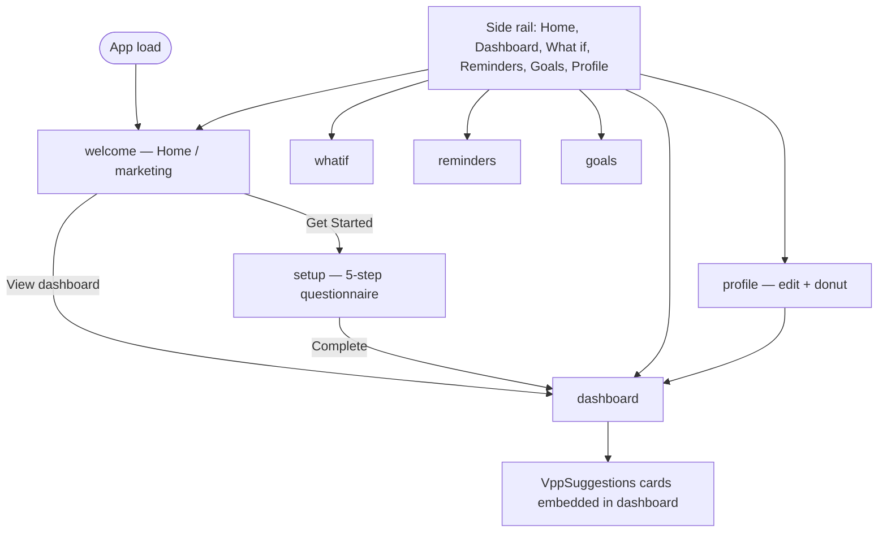
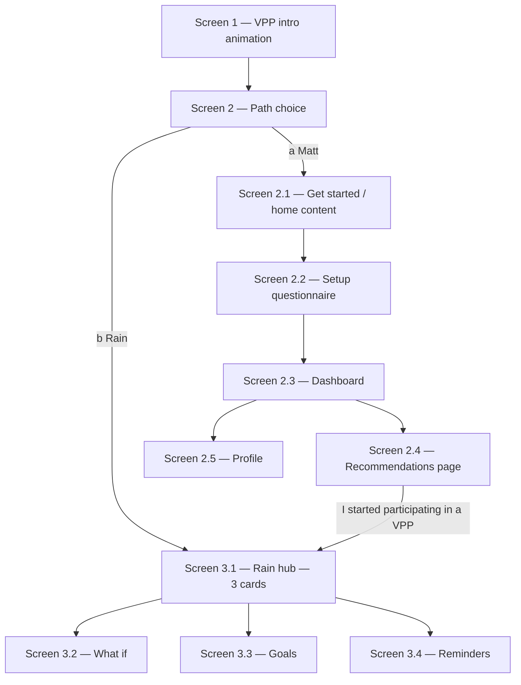
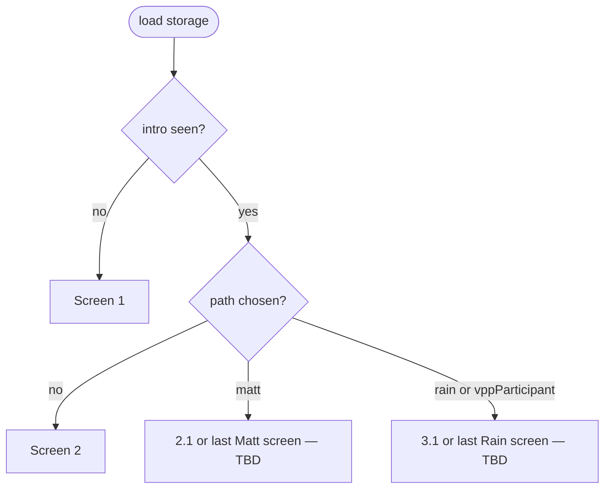

# MyPowerPlant — Dual user flows (Matt vs Rain)

**Status:** Implemented (frontend)  
**Date:** 2026-10-09

This document maps the **current** in-app journey, the **proposed** Matt / Rain split, screen IDs aligned with your spec, and what we would build vs reuse.

---

## Personas

| Persona | Who | Goal in the product |
|--------|-----|---------------------|
| **Matt** | Has solar + battery, **not** in a VPP yet | Understand value, model the home, compare plans, pick a VPP |
| **Rain** | Already enrolled in a VPP | Improve an existing setup via What if, Goals, Reminders |

**Transition:** Matt becomes Rain when they confirm **“I started participating in a VPP”** on the recommendation page (Screen 2.4). After that, the app treats them as Rain (same device, persisted flag).

---

## Current state (as implemented today)

### Routing model

- Single client-side router in `frontend/src/App.tsx` — no URL paths, no React Router.
- **Views:** `welcome` | `setup` | `profile` | `dashboard` | `whatif` | `reminders` | `goals`
- **Persistence:** household profile only (`localStorage` key `mypowerplant.profile` via `profileStorage.ts`). No persona / onboarding / VPP-participation flags.

### Default journey (everyone)



### Notable behaviour today

| Area | Behaviour |
|------|-----------|
| **Home (`Welcome`)** | Hero, `HeroHouse`, VPP explainer carousel, articles; CTA → setup or dashboard if profile exists |
| **Setup (`SetupForm`)** | Privacy intro dialog, then household → usage → solar → battery → provider; completes → **dashboard** |
| **Dashboard** | Energy river, VPP cost compare, **`VppSuggestions`** (plan cards + dialogs) — **not** a separate page |
| **Profile** | Sectioned editor (same steps as setup) + **`ConsumptionDonut`** |
| **What if / Goals / Reminders** | Always reachable from rail (even before setup); features prompt to complete setup when needed |
| **Chat dock** | Actions + What if tray on all shell views |

There is **no** shared intro animation screen or fork between “new to VPP” vs “already in VPP”.

---

## Proposed journey (high level)

**Every first-time session (and policy TBD for return visits):**

1. **Screen 1** — VPP concept intro (animated sun → solar → battery → network)
2. **Screen 2** — Path choice: **(a) Get started with VPPs** (Matt) or **(b) Let’s improve my VPP setup** (Rain)

Then branch:



---

## Screen catalogue

### Shared onboarding

| ID | Name | New / existing | Proposed implementation |
|----|------|----------------|-------------------------|
| **1** | VPP intro animation | **New** | Full-screen step before path choice; match site theme (deep green bands, serif headings, orange accents). Animation: sun → panels → battery → grid of batteries / network. *Candidate reuse:* parts of `HeroHouse`, `VppExplainerCarousel` diagram — likely a dedicated `VppIntroAnimation` component. |
| **2** | Path choice (Matt vs Rain) | **New** | Two large choices: “Get started with VPPs” / “Let’s improve my VPP setup”. Sets persisted **user path** (`matt` \| `rain`). |

### Flow A — Matt (get started with VPPs)

| ID | Name | New / existing | Maps to today |
|----|------|----------------|---------------|
| **2.1** | Get started / VPP introduction | **Existing (relocate in flow)** | Current `Welcome` — hero, carousel, “how it helps”, articles. Entry only after Screen 2 choice (a), not raw app load. |
| **2.2** | Household questionnaire | **Existing** | `SetupForm` + `SetupIntroDialog` |
| **2.3** | Dashboard | **Existing** | `DashboardView` — **VPP plan cards removed from main story** (moved to 2.4) |
| **2.4** | VPP recommendations | **New page** | Extract / wrap `VppSuggestions` (+ page chrome from mockup: heading, 2×2 grid, TOP MATCH, “Why it suits you”, “Learn more”). Add section: **“I started participating in a VPP”** → set `vppParticipant: true`, path → Rain, navigate to **3.1**. |
| **2.5** | Profile | **Existing** | `ProfileView` (questionnaire sections + donut) |

**Matt navigation (proposed):** Home (2.1), Dashboard, **Recommendations**, Profile.  
**Hidden or locked for Matt:** What if, Goals, Reminders (Rain tools) — unless you want them discoverable with a “complete VPP signup first” message.

### Flow B — Rain (improve my VPP setup)

| ID | Name | New / existing | Maps to today |
|----|------|----------------|---------------|
| **3.1** | Rain hub (“Great! What would you like to do?”) | **New** | Three cards: What if, Goal, Reminder — per mockup (previews + CTAs). Dark hub layout. |
| **3.2** | What if | **Existing** | `WhatIfView` |
| **3.3** | Goals | **Existing** | `GoalsView` |
| **3.4** | Reminders | **Existing** | `RemindersView` |

**Rain navigation (proposed):** Hub (3.1) as primary “home”, plus What if, Goals, Reminders.  
**Dashboard / recommendations:** Optional for Rain — *see open questions* (profile may still power KPIs).

**Entry to Rain:**

- Screen 2 choice (b), or  
- Matt confirms VPP participation on 2.4.

---

## State & persistence (proposed)

New local-only keys (names illustrative):

| Field | Purpose |
|-------|---------|
| `onboarding.introSeen` | Screen 1 completed |
| `onboarding.pathChosen` | `matt` \| `rain` |
| `user.vppParticipant` | `true` after 2.4 confirmation (Matt → Rain) |
| `mypowerplant.profile` | Unchanged — still required for personalised dashboard / tools |

**Derived persona (for UI):**

```text
if vppParticipant OR pathChosen === 'rain' → Rain
else if pathChosen === 'matt' → Matt
else → pre-choice (only Screens 1–2)
```

**App entry logic (proposed):**



---

## UI / chrome changes (summary)

| Element | Matt | Rain |
|---------|------|------|
| **Side rail** | Home, Dashboard, Recommendations, Profile | Hub, What if, Goals, Reminders (+ Profile? TBD) |
| **Dashboard** | Numbers + river; link/CTA to Recommendations | TBD — omit or read-only summary |
| **Chat dock** | Keep as today? | Keep as today? |
| **Screen 1–2** | No rail (fullscreen onboarding) | Same |

---

## Component / file impact (implementation preview)

| Work item | Likely touch points |
|-----------|---------------------|
| New views in `App.tsx` | `intro`, `pathChoice`, `recommendations`, `rainHub` (+ extend `View` union) |
| Onboarding storage | `constants/storage.ts`, small `lib/onboardingStorage.ts` |
| Screen 1 | `components/onboarding/VppIntroScreen.tsx` (+ CSS) |
| Screen 2 | `components/onboarding/PathChoiceScreen.tsx` |
| Screen 2.4 | `components/recommendations/RecommendationsView.tsx` reusing `VppSuggestions` |
| Screen 3.1 | `components/rain/RainHubView.tsx` |
| Dashboard trim | `DashboardView.tsx` — remove or replace inline `VppSuggestions` with CTA to 2.4 |
| Navigation | `constants/navigation.ts`, `AppShell.tsx` — persona-aware `NAV` sets |
| Matt → Rain | Handler on 2.4 updates storage + `setView('rainHub')` |

---

## Existing users (migration)

Anyone with `profile.lastUpdated` set today has **no** path flags.

**Proposed default (please confirm):**

- **Option A — Soft:** Show Screen 1 + 2 once; if they already have a profile, pre-select or suggest Matt and land on 2.3 or 2.1.  
- **Option B — Skip fork:** If profile exists, infer Matt until they click “I started participating in a VPP”.  
- **Option C — Ask Rain explicitly:** Always show Screen 2 even for return users.

---

## Acceptance checklist (for implementation phase)

- [ ] New visitor: 1 → 2 → Matt → 2.1 → 2.2 → 2.3 → 2.4 → participate → 3.1 → 3.2/3.3/3.4  
- [ ] New visitor: 1 → 2 → Rain → 3.1 → tools  
- [ ] Matt rail does not expose Rain-only tools (or shows clear lock state)  
- [ ] Recommendations page matches dashboard card behaviour (dialogs, matching)  
- [ ] Participate CTA flips persona and persists across refresh  
- [ ] Profile and dashboard still work for Matt after moving VPP cards  
- [ ] Reduced-motion respected on Screen 1 animation  

---

## Open questions (need your answers before build)

1. **Screen 1 frequency** — Only the very first visit ever, or every time until “Don’t show again”, or every app open until path is chosen?

2. **Rain without a profile** — If someone picks “Let’s improve my VPP setup” on Screen 2 but has no saved questionnaire, do we:
   - (a) force setup first (minimal or full 2.2),  
   - (b) allow 3.1 with generic placeholders, or  
   - (c) a shortened “VPP user” setup (battery + provider only)?

3. **Rain and Dashboard / Profile** — Should Rain still see Dashboard (2.3) and Profile (2.5) in the rail, or only the hub + three tools?

4. **Matt and the chat dock** — Keep Actions + What if tray for Matt during exploration, or hide What if until they become Rain? (Today What if is always on the rail.)

5. **Recommendations access** — Only from dashboard CTA, or also a permanent rail item for Matt?

6. **“I started participating in a VPP”** — One-click only (no provider/plan picker), or optional “which plan” tied to `profile.provider`?

7. **Screen 1 animation** — Prefer a **new** short auto-play animation, or adapt the existing **carousel / HeroHouse** into a single condensed intro?

8. **URLs** — Stay on in-memory views only, or add path-based routes (`/onboarding`, `/recommendations`, …) for deep linking and refresh?

9. **Existing saved profiles** — Which migration option (A / B / C above)?

10. **Branding on hub** — Screen 3.1 mockup uses a dark full-page hub; Screen 2.4 mockup uses light beige + white cards. Confirm: 3.1 dark, 2.4 light (same as current dashboard bands), both valid.

---

## Approval

Once you confirm the open questions (or defaults you’re happy with), implementation can proceed in the order:

1. Onboarding storage + App entry routing (Screens 1–2)  
2. Persona-aware navigation  
3. Recommendations page + Matt dashboard tweak  
4. Rain hub (3.1)  
5. Matt → Rain transition on 2.4  
6. Migration behaviour for existing local profiles  

**Please reply with answers or edits to this doc; no code changes until you approve.**
